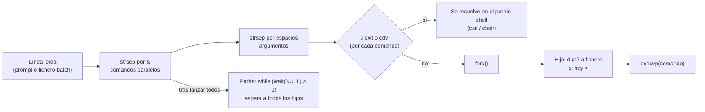

<div align="center">

# UVash: un shell de Unix escrito en C

**Intérprete de comandos con ejecución en paralelo y redirección, construido sobre `fork`, `execvp`, `wait` y `dup2`, más versiones propias de `cat`, `grep`, `zip` y `unzip`**


<sub>Estructura de Sistemas Operativos · Grado en Ingeniería Informática · Universidad de Valladolid · Curso 2022-2023</sub>

</div>



## En pocas palabras

- **Reto**: escribir un shell de Unix y utilidades clásicas en C usando directamente las llamadas al sistema, sin bibliotecas que oculten la gestión de procesos.
- **Solución**: `UVash`, con modo interactivo y modo batch, comandos internos `exit` y `cd`, redirección con `>` y ejecución en paralelo con `&`; además `UVacat`, `UVagrep` y un compresor RLE (`UVazip` / `UVaunzip`).
- **Demuestra**: programación de sistemas en C, gestión de procesos POSIX, redirección de descriptores, análisis robusto de la entrada y trabajo guiado por baterías de pruebas.

## Lo más destacado

- **UVash pasa 22/22 pruebas** de la batería de OSTEP y **UVacat 7/7** (compilados con gcc en Linux/WSL sobre una copia del repositorio).
- **Ejecución en paralelo real**: cada comando separado por `&` se lanza con `fork` + `execvp` y el shell espera a todos con `while (wait(NULL) > 0)`, así que corren a la vez y no uno tras otro.
- **Redirección con `dup2`**: el hijo redirige la salida estándar y la de error al fichero indicado tras `>`; antes, el shell rechaza las redirecciones mal formadas (sin fichero o con varios).
- **Comandos internos sin `fork`**: `exit` y `cd` se resuelven en el propio proceso, porque un hijo no puede cambiar el directorio de trabajo de su padre.
- **Análisis de la línea con casos límite**: espacios y tabuladores sobrantes se normalizan, y una línea con solo `&` o solo espacios produce un único mensaje de error por `stderr`.
- **Formato binario propio**: `UVazip` escribe cada tramo como un entero de 4 bytes seguido del carácter (`fwrite`), el formato que lee `UVaunzip`.

## Competencias

| Área | Qué se aplicó |
| --- | --- |
| Programación de sistemas | C sobre la API POSIX: `fork`, `execvp`, `wait`, `dup2`, `chdir`, `opendir`/`readdir` |
| Procesos y concurrencia | Lanzamiento de varios hijos en paralelo y espera de todos ellos |
| E/S y ficheros | Redirección de descriptores, E/S binaria con `fwrite`/`fread` |
| Pruebas | Baterías automáticas con el *tester* de OSTEP (`test-*.sh`) |
| Memoria virtual | Simuladores OSTEP de reubicación, segmentación, paginación y `malloc` (Python) |

## Qué contiene

| Práctica | Contenido |
| --- | --- |
| Práctica 1: utilidades Unix | `UVacat`, `UVagrep`, `UVazip` y `UVaunzip`: versiones simplificadas de `cat`, `grep` y de un compresor RLE con su descompresor. |
| Práctica 2: shell `UVash` | Intérprete con modo interactivo (prompt `UVash> `) y modo batch (lee órdenes de un fichero), comandos internos `exit` y `cd`, redirección de salida con `>` y ejecución en paralelo con `&`. |
| Examen de laboratorio (22/03/2023) | Ampliación de `UVash` con un comando interno `PACK` (ejercicio 1) y `UVafind`, un buscador de ficheros por nombre en el directorio actual con la opción `--name` (ejercicio 2). |
| Deberes (`homework/`) | Simuladores en Python del libro OSTEP sobre memoria: reubicación, segmentación, paginación lineal y multinivel, y `malloc`. |

Los enunciados, en inglés, están en el `README.md` de cada práctica. Proceden de los proyectos OSTEP de la Universidad de Wisconsin-Madison, adaptados para la asignatura.

## Estructura del repositorio

```text
ESO/
├── homework/                  # Simuladores OSTEP de memoria (Python)
└── laboratorio-eso/
    ├── initial-reverse/       # Enunciado y tests de calentamiento (sin solución)
    ├── Practica1/
    │   ├── UVacat/  UVagrep/  UVazip/  UVaunzip/   # Fuente .c, test-*.sh y tests/
    ├── Practica2/
    │   ├── UVash.c            # Shell
    │   ├── test-UVash.sh  tests/
    │   ├── estudioExamen/     # Versiones de preparación del examen
    │   └── modificacionExamenESO/   # Examen: PACK (ejercicio1) y UVafind (ejercicio2)
    └── tester/                # Framework de pruebas de OSTEP
```

## Requisitos

- Linux (o WSL) con `gcc` y `bash`.
- Python 2 para `paging-linear-translate.py`, `paging-multilevel-translate.py` y `malloc.py`, que usan `print` como sentencia.

## Cómo ejecutarlo

Cada programa se compila con `gcc` y se prueba con el script `test-*.sh` de su carpeta, que ejecuta los casos de `tests/` con `../tester/run-tests.sh` (`-c` continúa tras un fallo).

<details>
<summary>Compilar y probar UVash y UVacat</summary>

```sh
cd laboratorio-eso/Practica2
gcc -Wall -o UVash UVash.c
./test-UVash.sh          # batería de pruebas
./UVash                  # modo interactivo
./UVash fichero.txt      # modo batch

cd ../Practica1/UVacat
gcc -o UVacat UVacat.c
./test-UVacat.sh
```

Para las demás utilidades, cambia el nombre (`UVagrep`, `UVazip`, `UVaunzip`).

</details>

## Estado y limitaciones

Resultado de las baterías al compilar con gcc en Linux (WSL), sobre una copia del repositorio: `UVash` 22/22 y `UVacat` 7/7; `UVagrep` pasa 5/7, `UVazip` 4/6 y `UVaunzip` 1/6.

## Autoría

Javier García González (JavivuG).

---

<div align="center"><sub>Parte de <a href="https://github.com/JavivuG/UVa-Projects">UVa-Projects</a> · Javier García González</sub></div>
